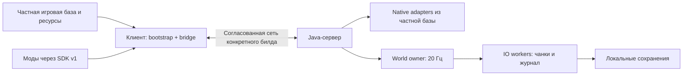

# Архитектура

- `server/.../net` — framing, вход, надёжная доставка, репликация и инвентарь.
- `server/.../world` — мир, геометрия, чанки, контроллеры и состояние симуляции.
- `server/.../persistence` и `commands` — durable journal, транзакции, checkpoint и обслуживание.
- `server/.../client` — граница с игровыми сериализаторами и закреплённым ABI.
- `client/bootstrap` и `client/mod-runtime` — вход в клиент и callbacks модов.
- `client/resource-compat` — правки читателей новых форматов; игровые JSON остаются входными данными.
- `desktop` — GUI запуска. Оно не рассчитывает игровую физику и не хранит рабочие ключи в Git.

Для FPV пилот симулирует полёт, столкновения, отклик, батарею и мотор.
Сервер управляет размещением, жизненным циклом, рассылкой состояния и подписками.

Исходная карта и рабочие сохранения — отдельные сущности. База подключается как Map,
а изменения и аккаунты живут в частной data-директории экземпляра сервера.
